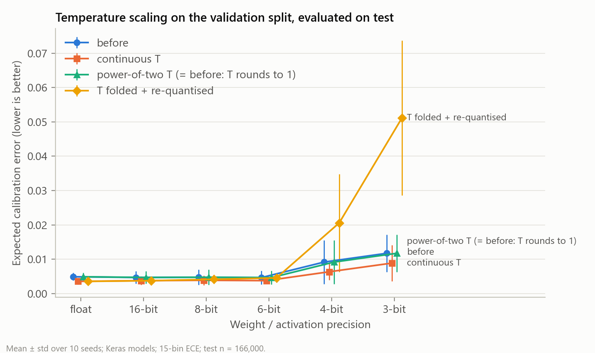
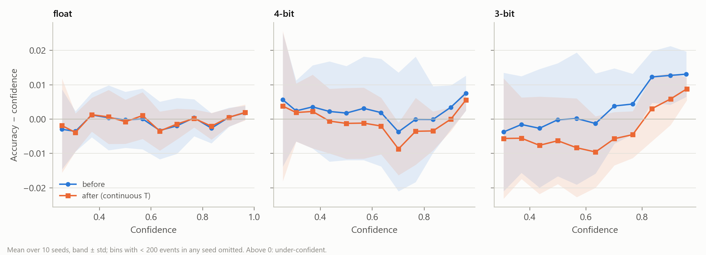

# Quantised neural networks on an FPGA: does reliability break before accuracy?

A jet-tagging MLP (15 → 32 → 32 → 5) is trained in float and with quantisation-aware training (QKeras) at
16, 8, 6, 4 and 3 bits, 10 seeds each, then compiled with hls4ml for the AMD Kria KR260 (xck26) at 200 MHz.
Besides accuracy, every model is scored on **calibration** (ECE) and **background mass sculpting**
(how much a top-tag cut distorts the QCD jet-mass distribution, the jet mass being withheld from the inputs).

**Answer: no, not in order; yes, in size.** Accuracy is the first metric to move significantly (from 6 bits,
by 0.1 point). Calibration and sculpting only move at 4 bits and below, and significantly (after
multiple-comparison correction) only at 3 bits, but then by far more in relative terms: at 3 bits accuracy
falls 1.5% while calibration error rises 140% (paired p_Holm = 0.029) and sculpting 74% (cross-seed JSD,
paired p_Holm = 0.049), and both become strongly seed-dependent. Down to 6 bits the models are
indistinguishable from float on reliability.

**Deployed on the board:** the **4-bit** model runs on the KR260, bit-exact on all 166,000 test events, in
**75 ns on chip, 27× faster than the board's ARM Cortex-A53 (2.01 µs)**. Driven from the ARM one event at a
time it takes 1.65 µs end to end, only **1.2× faster** than the CPU, because bus access dominates
([details](#on-board-deployment-kr260)).


## Results

Mean ± std over 10 seeds on the full test split (n = 166,000). Hardware: seed-0 model, ReuseFactor 1,
xck26 at a 200 MHz target, out-of-context post-route where available (full table: [results/summary.md](results/summary.md)).

| bits | accuracy | ECE | sculpting JSD vs float (cross-seed) | latency | clock | LUT | DSP | fits KR260 |
|---|---|---|---|---|---|---|---|---|
| float | 0.7282 ± 0.0003 | 0.0049 ± 0.0011 | 0.0233 ± 0.0040 (noise floor) | – | – | – | – | – |
| 16 | 0.7282 ± 0.0004 | 0.0047 ± 0.0018 | 0.0230 ± 0.0051 | 85 ns | 200 MHz | 82,268 (HLS est.) | 1,617 | **no** (130% of DSPs) |
| 8 | 0.7280 ± 0.0004 | 0.0047 ± 0.0022 | 0.0234 ± 0.0047 | 77 ns | 182 MHz | 35,429 | 280 | yes |
| 6 | 0.7274 ± 0.0004 | 0.0046 ± 0.0019 | 0.0244 ± 0.0052 | 71 ns | 198 MHz | 25,903 | 59 | yes |
| 4 | 0.7236 ± 0.0006 | 0.0092 ± 0.0063 | 0.0304 ± 0.0076 | 65 ns | 200 MHz | 16,114 | 5 | yes |
| 3 | 0.7175 ± 0.0022 | 0.0117 ± 0.0054 | 0.0406 ± 0.0141 | 60 ns | 200 MHz | 11,854 | 5 | yes |

Statistics (paired Wilcoxon vs same-seed float, Holm-corrected per metric; [results/paired_tests.csv](results/paired_tests.csv)):
accuracy drops significantly from 6 bits (−0.09 / −0.45 / −1.05 points at 6/4/3 bits, p_Holm = 0.010);
ECE +88% at 4 bits (p_Holm = 0.055, borderline) and +140% at 3 bits (p_Holm = 0.029);
sculpting (cross-seed JSD: each model's after-cut QCD mass shape vs the float models of the *other* seeds,
so seed s of float and of each bit width share the same reference set) +31% at 4 bits (p = 0.027,
p_Holm = 0.11, not significant after correction) and +74% at 3 bits (p = 0.0098, p_Holm = 0.049).
n = 10 seeds per test; the smallest attainable two-sided Wilcoxon p is 0.002.


**Where the calibration error comes from.** Quantised models are not over-confident; the 3-bit (and more
weakly 4-bit) models become *under*-confident at high confidence, with accuracy ~1.3 points above the
stated confidence for scores above 0.8. Seed-to-seed spread is large, so read this as a trend.


**Sculpting.** The tagger already sculpts QCD mass heavily in float (the cut selects top-like masses);
quantisation adds a small further distortion at 3–4 bits:


### Post-hoc calibration: does temperature scaling close the gap?

**No.** Temperature scaling lowers ECE at every bit width, but float improves by a similar amount, so the
quantised-vs-float gap at 4 and 3 bits remains; and on hardware the softmax approximation is a bigger
calibration error than quantisation itself. Full tables: [results/calib_summary.md](results/calib_summary.md).

Setup ([calibrate.py](calibrate.py)): one temperature T per model (all 60), fitted by NLL on the Keras
validation split, i.e. the last 20% of the training arrays that `model.fit(validation_split=0.2)` held out.
**That split was also used for early stopping**, so it is not independent of model selection; the test set is
used only for evaluation. Three variants: continuous T (needs a multiplier in hardware); T rounded to the
nearest power of two, folded into the output layer as a binary-point shift (exact, free in hardware); and
1/T folded into the output-layer weights and re-quantised at the same bit width, with the integer part widened
just enough to avoid clipping. Paired Wilcoxon over seeds, Holm-corrected; 95% CIs from a seed bootstrap.

| bits | ECE before | continuous T | gap to calibrated float | folded + re-quantised |
|---|---|---|---|---|
| float | 0.0049 ± 0.0011 | 0.0035 ± 0.0009 | – | 0.0035 ± 0.0009 |
| 6 | 0.0046 ± 0.0019 | 0.0037 ± 0.0008 | +0.0002 (p_Holm = 1) | 0.0045 ± 0.0014 |
| 4 | 0.0092 ± 0.0063 | 0.0063 ± 0.0024 | **+0.0028** (p_Holm = 0.020) | 0.0206 ± 0.0143 |
| 3 | 0.0117 ± 0.0054 | 0.0089 ± 0.0052 | **+0.0053** (p_Holm = 0.020) | 0.0511 ± 0.0226 |

- **Continuous T helps a little.** ECE falls by 0.0009–0.0029 (seed-bootstrap 95% CIs exclude zero at every
  bit width), significant after Holm only for float (p_Holm = 0.035); accuracy is unchanged by construction
  (asserted), and NLL/Brier move by ≤ 0.0004.
- **The gap does not close.** After calibration, 4- and 3-bit ECE is still significantly above calibrated float;
  the change in the gap is not significant (4 bits: −0.0015, 95% CI [−0.0051, +0.0008]). A single temperature
  cannot fix the 3-bit models' confidence-dependent miscalibration (under-confident at high confidence): it
  shifts the whole curve, trading mid-range for high-range error.
- **A power-of-two temperature is a no-op here.** All 60 fitted T lie in [0.93, 1.03], so the nearest power of
  two is 1; a binary-point shift can only rescale logits by factors of 2.
- **Folding T into the weights and re-quantising backfires at low precision.** For T < 1 the scaled weights
  need one more integer bit, which costs one fractional bit at fixed width: 3-bit ECE rises from 0.0117 to
  0.0511 (p_Holm = 0.023) and 3.6% of predictions change.
- **On hardware the softmax approximation dominates.** hls4ml's lookup-table softmax outputs sum to 1.08 on
  average (range 0.996–1.25), raising mean confidence from about 0.72 to 0.78 at unchanged accuracy. In
  fixed-point C simulation of the seed-0 models (bit-exact with the board for the deployed 4-bit model), raw
  ECE is 0.051–0.074 at every precision, including the 16-bit post-training-quantised float model, versus
  0.004–0.013 in Keras; dividing the outputs by their sum brings it back to 0.007–0.011. For calibrated outputs
  on this hardware, renormalising (or a more accurate softmax) matters far more than temperature.





### hls4ml softmax: the hardware's calibration error has a one-type fix

**Cause.** hls4ml's `stable` softmax looks up `exp(x)` and `1/Σexp` in tables indexed by the **top 10 bits** of
each table's input type. By default the 1/Σ lookup is addressed through `inv_inp_t = fixed<18,8>`: sign,
7 integer bits and only 2 fractional bits, i.e. 0.25-wide bins over a sum that always lies in [1, 5]. The
outputs then sum to 1.08 on average (0.996–1.249) and every probability is inflated.
([softmax_study.py](softmax_study.py), [results/softmax_summary.md](results/softmax_summary.md))

**Across seeds** (deployed configuration, 10 seeds each, paired Wilcoxon, Holm): raw hardware ECE is
0.057 ± 0.009 at 4 bits and 0.058 ± 0.005 for the float model quantised post-training, against 0.009 / 0.005
in Keras. Raw minus renormalised ECE is +0.047 (4-bit) and +0.052 (float), p = 0.002 for both (the smallest
p attainable with 10 pairs; p_Holm = 0.004). Renormalised ECE is indistinguishable from Keras (95% CIs include 0).

**Config sweep** (4-bit seed 0, all 166,000 test events; Keras ECE of this model 0.0128):

| softmax config | output sum [min, max] | ECE (raw) | cycles | HLS LUT / BRAM_18K | post-route LUT, WNS @ 200 MHz |
|---|---|---|---|---|---|
| A deployed default | 1.085 [0.996, 1.249] | 0.0735 | 13 | 38,360 / 4 | 16,114, +0.041 ns |
| B table size 4096 | 1.021 [0.996, 1.062] | 0.0300 | 13 | 38,392 / 13 | – |
| **C `inv_inp_t` = `ufixed<18,3>`** | **1.000 [0.995, 1.006]** | **0.0105** | **13** | **38,360 / 4** | **16,070, +0.211 ns** |
| D C + table values `ufixed<18,1>` | 1.000 [0.996, 1.007] | 0.0102 | 13 | 38,519 / 4 | – |
| E D + table size 4096 | 0.998 [0.996, 1.001] | 0.0120 | 13 | 38,519 / 16 | – |
| F `latency` implementation | 1.009 [0.938, 1.079] | 0.0189 | 11 | 38,327 / 4 | – |
| G softmax skipped (logits out) | – | 0.0126 (exact softmax on ARM) | 6 | 37,817 / 0 | – |

**The fix holds across seeds:** with config C, 4-bit raw ECE is 0.0093 ± 0.0071 over 10 seeds, versus
0.0092 ± 0.0063 in Keras (difference +0.0001, 95% CI [−0.0009, +0.0011]) and −0.048 versus the deployed
default (p_Holm = 0.004). It costs nothing measurable: identical HLS latency and resources, and post-route
16,070 vs 16,114 LUTs with the same FF/DSP/BRAM, timing met (the slack difference is within place-and-route
variation). The deployed softmax also cost 0.002 of top-tag AUC (0.9363 vs 0.9381), which C recovers.

**Which fix, at what cost** (ARM numbers measured on the KR260's A53 @ 1.33 GHz, loop mean per event,
[results/board_arm_post.txt](results/board_arm_post.txt)):

| fix | ECE (4-bit) | extra FPGA cost | extra ARM time | usable if data stays in the fabric |
|---|---|---|---|---|
| (i) renormalise outputs on the ARM | 0.0099 ± 0.0074 | none (no rebuild) | +19 ns (49 vs 31 ns) | no |
| (ii) `inv_inp_t` = `ufixed<18,3>` (config C) | 0.0093 ± 0.0071 | none | 0 | **yes** |
| (iii) skip softmax, exact softmax on the ARM | 0.0126 (seed 0) | saves 7 of 13 cycles, 5 DSP, 4 BRAM_18K | +243 ns (273 vs 31 ns) | no |

Recommendation: **(ii)**, rebuilding with the wider-resolution 1/Σ lookup input, is free in hardware and
fixes calibration at the source, including trigger-style data paths that never reach a CPU. (i) is the
zero-rebuild patch for an existing bitstream such as the one deployed here. (iii) saves FPGA latency and
DSPs, but on this board the A53 spends ~240 ns on the softmax, far more than the 35 ns it saves on chip.

**Caveat for hls4ml 1.3.0 users:** softmax table types given in the layer config (`Precision: inv_inp /
exp_table / inv_table / accum`) are **silently ignored**; the Softmax layer never reads them, and only
`TableSize`, `Implementation` and `Skip` take effect. Config C was applied by editing the converted node
(`hls_model.graph[<softmax>].get_attr('inv_inp_t').precision`) before `compile()`, and checked in the
generated `defines.h`.

**Upstream status** (fastmachinelearning/hls4ml, checked 2026-11-05): v1.3.0 (March 2026) is the latest
release and ships these `fixed<18,8>` defaults. Issue
[#1512](https://github.com/fastmachinelearning/hls4ml/issues/1512) (open) reports silent argmax flips from the
softmax lookup tables in 1.3.0 and suggests the skip-softmax workaround; a fix raising the 1/x-table input
width ([#1513](https://github.com/fastmachinelearning/hls4ml/pull/1513)) was closed without merging. Maintainer
PR [#1542](https://github.com/fastmachinelearning/hls4ml/pull/1542) (open, not merged or released) makes the
stable-softmax table types inferred (`auto`) and fixes the configuration path that "had no effect". I found
no report of the outputs not summing to 1 or of the effect on calibration.

**Hardware notes.** HLS C-synthesis overestimates LUTs by ~2.4× versus post-route (3-bit: 28.7k vs 11.9k),
so post-route numbers are quoted. 16-bit needs more DSPs than the device has at ReuseFactor 1; at
ReuseFactor 2 it fits on paper (837 DSPs) but did not route at 5 ns within 2 h on a 14 GB laptop.

## On-board deployment (KR260)

**Result (4-bit model, seed 0): bit-exact on the board; 75 ns on chip vs 2.01 µs on the ARM CPU (27× faster);
1.65 µs end to end, i.e. 1.2× faster than the CPU when the ARM drives it one event at a time.**

The 4-bit model (seed 0, ReuseFactor 1) was chosen because it keeps accuracy within 0.5 point of float at
5 DSPs; it is wrapped with an AXI-Lite interface and built into a full KR260 design
(Zynq MPSoC → SmartConnect → core, plus an on-chip cycle counter): see [DEPLOY.md](DEPLOY.md) and `deploy/`.

| | status |
|---|---|
| Wrapper C-sim vs hls4ml core | bit-exact, 2,000/2,000 events |
| Wrapper latency (HLS) | 14 cycles = 70 ns at 200 MHz |
| Full design timing | met at 200 MHz, WNS +0.306 ns |
| Full design resources | 15,479 LUT (13%), 4,666 FF, 5 DSP, 4 RAMB18 |
| Golden model (hls4ml C++, all test events) | accuracy 0.7237 (Keras: 0.7241) |
| **On-board bit-exact validation** | **166,000 / 166,000 events, 0 output mismatches**; board accuracy 0.7237 |
| **On-chip latency** (cycle counter, ap_start → ap_done) | **15 cycles = 75 ns** at 200 MHz, identical for every event |
| **End-to-end latency, batch 1** (ARM → AXI-Lite → FPGA → ARM, C driver) | **median 1.65 µs**, p99 1.84 µs |
| **ARM Cortex-A53 @ 1.33 GHz**, same network in C (-O3) | **median 2.01 µs**, p99 2.35 µs (accuracy 0.7241) |

Measured on the board ([results/board.csv](results/board.csv), raw output in `results/board_*.txt`,
environment in [results/board_env.txt](results/board_env.txt)): the FPGA computes one inference in 75 ns,
**27× faster than the A53**. Driven from the ARM one event at a time, the ~11 AXI-Lite register accesses
dominate, and end to end the FPGA is only **1.2× faster** (1.65 vs 2.01 µs). The 75 ns figure is the
relevant one when the data arrives in the fabric (e.g. a trigger path); for CPU-fed use, batching or
streaming (AXI-Stream + DMA) would be needed to expose it. Latencies are per call over 100,000 events on a
pinned core, timer overhead ~70 ns included.

## Reproduce

Environment: Python 3.10, `pip install -r requirements.txt` (TensorFlow 2.14, **numpy < 2**, QKeras, hls4ml 1.3).
Synthesis and implementation: Vivado/Vitis 2026.1 (Linux / WSL).

```bash
python sweep.py                 # train 60 models, metrics  -> results/sweep.csv, models/   (~2 h CPU)
python analyze.py               # summaries, paired tests, figures/
python plots.py                 # plots/relative_change, metrics_vs_bits, mass_after_cut
python reliability.py           # plots/reliability.png
python calibrate.py --keras     # temperature fits + variants for all 60 models (cache/calib/)
bash run_calib_hls.sh           # hls4ml fixed-point outputs of the seed-0 variants                 (WSL)
python calibrate.py --report    # results/calib*.{csv,md}, plots/calib_*.png
bash run_softmax.sh configs --synth                          # softmax configs A-G: csim + HLS (WSL)
bash run_softmax.sh seeds --config A_default --bits 4 float  # seeds 0-9 (also --config C_invinp --bits 4)
bash run_softmax.sh impl --configs A_default C_invinp        # post-route
bash run_softmax.sh report                                   # results/softmax_*.{csv,md}
bash run_synth.sh               # hls4ml + Vitis HLS per bit width -> results/hw.csv     (WSL)
bash run_impl.sh                # Vivado OOC place & route         -> results/impl.csv   (WSL)

bash deploy/run_axi.sh          # AXI wrapper IP (C-sim + synth + export)                (WSL)
bash deploy/run_bd.sh           # KR260 bitstream -> deploy/overlay/qnn.{bit,hwh}         (WSL)
python deploy/export_testvec.py && bash deploy/run_golden.sh   # test vectors + golden outputs
# on the board: see deploy/board/README.md; then on the PC:
python deploy/parse_board.py results/board_*.txt               # -> results/board.csv
```

## Layout

| path | contents |
|---|---|
| `sweep.py` | data split, models, training, accuracy/AUC/ECE/sculpting |
| `synth.py`, `impl.py`, `vivado_impl.tcl` | hls4ml conversion, HLS synthesis, out-of-context place & route |
| `analyze.py`, `plots.py`, `reliability.py` | statistics and figures |
| `calibrate.py`, `calib_hls.py` | post-hoc temperature calibration (Keras and hls4ml fixed point) |
| `softmax_study.py` | hls4ml softmax configurations: calibration, resources, seeds |
| `deploy/` | AXI wrapper, block design, golden model, board drivers and benchmarks |
| `results/` | all numbers behind this README |
| `DEPLOY.md` | deployment plan and status |

## Limitations

- One architecture, one dataset; quantisation-aware training with a single QKeras recipe (`quantized_bits(b, 0)`).
- 10 seeds: enough for the accuracy effect, borderline for ECE at 4 bits.
- Hardware numbers are for the seed-0 model (HLS estimates across seeds 0–2 differ by ≤ ~5%).
- Out-of-context timing covers register-to-register paths of the core only; the full-design number above is in context.
