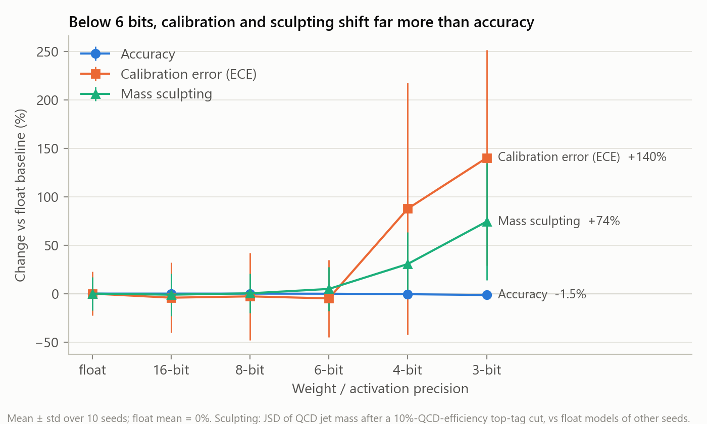
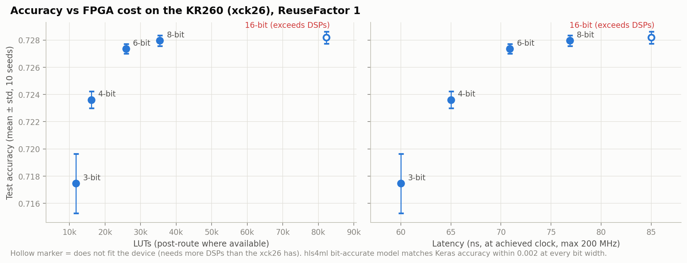
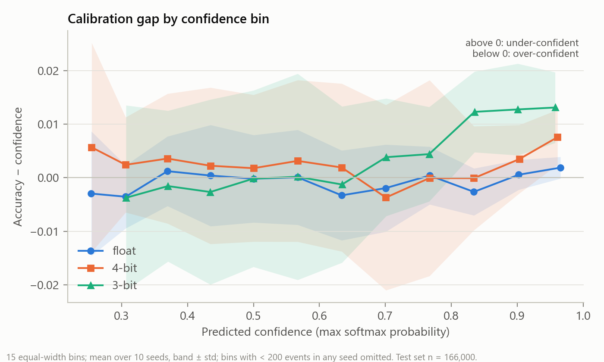
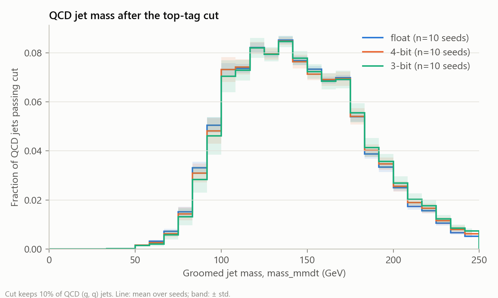

# Quantised neural networks on an FPGA: does reliability break before accuracy?

A jet-tagging MLP (15 → 32 → 32 → 5) is trained in float and with quantisation-aware training (QKeras) at
16, 8, 6, 4 and 3 bits, 10 seeds each, then compiled with hls4ml for the AMD Kria KR260 (xck26) at 200 MHz.
Besides accuracy, every model is scored on **calibration** (ECE) and **background mass sculpting**
(how much a top-tag cut distorts the QCD jet-mass distribution, the jet mass being withheld from the inputs).

**Answer: no, not in order; yes, in size.** Accuracy is the first metric to move significantly (from 6 bits,
by 0.1 point). Calibration and sculpting only change at 4 bits and below, but then by far more in relative
terms: at 3 bits accuracy falls 1.5% while calibration error rises 140% and sculpting 74%, and both become
strongly seed-dependent. Down to 6 bits the models are indistinguishable from float on reliability.



## Results

Mean ± std over 10 seeds on the full test split (n = 166,000). Hardware: seed-0 model, ReuseFactor 1,
xck26 at a 200 MHz target, out-of-context post-route where available (full table: [results/summary.md](results/summary.md)).

| bits | accuracy | ECE | sculpting JSD vs float | latency | clock | LUT | DSP | fits KR260 |
|---|---|---|---|---|---|---|---|---|
| float | 0.7282 ± 0.0003 | 0.0049 ± 0.0011 | 0.0233 ± 0.0040 (noise floor) | – | – | – | – | – |
| 16 | 0.7282 ± 0.0004 | 0.0047 ± 0.0018 | 0.0230 ± 0.0051 | 85 ns | 200 MHz | 82,268 (HLS est.) | 1,617 | **no** (130% of DSPs) |
| 8 | 0.7280 ± 0.0004 | 0.0047 ± 0.0022 | 0.0234 ± 0.0047 | 77 ns | 182 MHz | 35,429 | 280 | yes |
| 6 | 0.7274 ± 0.0004 | 0.0046 ± 0.0019 | 0.0244 ± 0.0052 | 71 ns | 198 MHz | 25,903 | 59 | yes |
| 4 | 0.7236 ± 0.0006 | 0.0092 ± 0.0063 | 0.0304 ± 0.0076 | 65 ns | 200 MHz | 16,114 | 5 | yes |
| 3 | 0.7175 ± 0.0022 | 0.0117 ± 0.0054 | 0.0406 ± 0.0141 | 60 ns | 200 MHz | 11,854 | 5 | yes |

Statistics (paired Wilcoxon vs same-seed float, Holm-corrected per metric; [results/paired_tests.csv](results/paired_tests.csv)):
accuracy drops significantly from 6 bits (−0.09 / −0.45 / −1.05 points at 6/4/3 bits, p_Holm = 0.010);
ECE +88% at 4 bits (p_Holm = 0.055, borderline) and +140% at 3 bits (p_Holm = 0.029).
Sculpting vs the float seed-to-seed noise floor (Mann-Whitney): 4 bits +31% (p = 0.04), 3 bits +74% (p = 0.003).



**Where the calibration error comes from.** Quantised models are not over-confident; the 3-bit (and more
weakly 4-bit) models become *under*-confident at high confidence, with accuracy ~1.3 points above the
stated confidence for scores above 0.8. Seed-to-seed spread is large, so read this as a trend.



**Sculpting.** The tagger already sculpts QCD mass heavily in float (the cut selects top-like masses);
quantisation adds a small further distortion at 3–4 bits:



**Hardware notes.** HLS C-synthesis overestimates LUTs by ~2.4× versus post-route (3-bit: 28.7k vs 11.9k),
so post-route numbers are quoted. 16-bit needs more DSPs than the device has at ReuseFactor 1; at
ReuseFactor 2 it fits on paper (837 DSPs) but did not route at 5 ns within 2 h on a 14 GB laptop.

## On-board deployment (KR260)

**Result: bit-exact on the board, 75 ns on-chip vs 2.01 µs on the ARM CPU (27×); 1.65 µs end to end.**

The 4-bit model is wrapped with an AXI-Lite interface and built into a full KR260 design
(Zynq MPSoC → SmartConnect → core, plus an on-chip cycle counter): see [DEPLOY.md](DEPLOY.md) and `deploy/`.

| | status |
|---|---|
| Wrapper C-sim vs hls4ml core | bit-exact, 2,000/2,000 events |
| Wrapper latency (HLS) | 14 cycles = 70 ns at 200 MHz |
| Full design timing | met at 200 MHz, WNS +0.306 ns |
| Full design resources | 15,479 LUT (13%), 4,666 FF, 5 DSP, 4 RAMB18 |
| Golden model (hls4ml C++, all test events) | accuracy 0.7237 (Keras: 0.7241) |
| **On-board bit-exact validation** | **166,000 / 166,000 events, 0 output mismatches**; board accuracy 0.7237 |
| **On-chip latency** (cycle counter, ap_start → ap_done) | **15 cycles = 75 ns** at 200 MHz, identical for every event |
| **End-to-end latency, batch 1** (ARM → AXI-Lite → FPGA → ARM, C driver) | **median 1.65 µs**, p99 1.84 µs |
| **ARM Cortex-A53 @ 1.33 GHz**, same network in C (-O3) | **median 2.01 µs**, p99 2.35 µs (accuracy 0.7241) |

Measured on the board ([results/board.csv](results/board.csv), raw output in `results/board_*.txt`,
environment in [results/board_env.txt](results/board_env.txt)): the FPGA computes one inference in 75 ns,
**27× faster than the A53**. Driven from the ARM one event at a time, the ~11 AXI-Lite register accesses
dominate, and end to end the FPGA is only **1.2× faster** (1.65 vs 2.01 µs). The 75 ns figure is the
relevant one when the data arrives in the fabric (e.g. a trigger path); for CPU-fed use, batching or
streaming (AXI-Stream + DMA) would be needed to expose it. Latencies are per call over 100,000 events on a
pinned core, timer overhead ~70 ns included.

## Reproduce

Environment: Python 3.10, `pip install -r requirements.txt` (TensorFlow 2.14, **numpy < 2**, QKeras, hls4ml 1.3).
Synthesis and implementation: Vivado/Vitis 2026.1 (Linux / WSL).

```bash
python sweep.py                 # train 60 models, metrics  -> results/sweep.csv, models/   (~2 h CPU)
python analyze.py               # summaries, paired tests, figures/
python plots.py                 # plots/relative_change, metrics_vs_bits, mass_after_cut
python reliability.py           # plots/reliability.png
bash run_synth.sh               # hls4ml + Vitis HLS per bit width -> results/hw.csv     (WSL)
bash run_impl.sh                # Vivado OOC place & route         -> results/impl.csv   (WSL)

bash deploy/run_axi.sh          # AXI wrapper IP (C-sim + synth + export)                (WSL)
bash deploy/run_bd.sh           # KR260 bitstream -> deploy/overlay/qnn.{bit,hwh}         (WSL)
python deploy/export_testvec.py && bash deploy/run_golden.sh   # test vectors + golden outputs
# on the board: see deploy/board/README.md; then on the PC:
python deploy/parse_board.py results/board_*.txt               # -> results/board.csv
```

## Layout

| path | contents |
|---|---|
| `sweep.py` | data split, models, training, accuracy/AUC/ECE/sculpting |
| `synth.py`, `impl.py`, `vivado_impl.tcl` | hls4ml conversion, HLS synthesis, out-of-context place & route |
| `analyze.py`, `plots.py`, `reliability.py` | statistics and figures |
| `deploy/` | AXI wrapper, block design, golden model, board drivers and benchmarks |
| `results/` | all numbers behind this README |
| `HANDOFF.md`, `DEPLOY.md` | project log and deployment plan |

## Limitations

- One architecture, one dataset; quantisation-aware training with a single QKeras recipe (`quantized_bits(b, 0)`).
- 10 seeds: enough for the accuracy effect, borderline for ECE at 4 bits.
- Hardware numbers are for the seed-0 model (HLS estimates across seeds 0–2 differ by ≤ ~5%).
- Out-of-context timing covers register-to-register paths of the core only; the full-design number above is in context.
